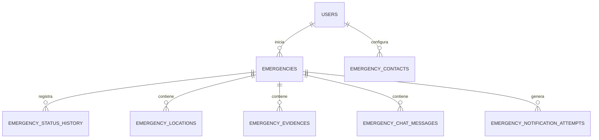

# 06 — Modelo de datos

> [!NOTE] INSTRUCTIONS
> Actualice el catálogo solo después de verificar el changelog vigente. No convierta una entidad objetivo en implementada.

## Resumen verificado

El modelo físico confirmado contiene 16 entidades distribuidas en siete esquemas PostgreSQL. La historia HU-DB-025 ya está aplicada y no se clasifica en refinamiento.

ADR-006 define un modelo objetivo de 14 entidades y seis esquemas al retirar las dos entidades exclusivas de FCM. Ese cambio todavía no está aplicado: requiere HU-DB-027 y una release verificada. Hasta entonces, las filas `notification.*` de la tabla siguiente describen el estado físico real.

| Esquema | Entidad | Responsabilidad |
|---|---|---|
| `configuration` | `system_configuration` | parámetros operativos globales |
| `identity` | `registration_requests` | registro previo y verificación |
| `identity` | `users` | cuentas y estado funcional |
| `identity` | `user_credentials` | credencial protegida por cuenta |
| `identity` | `user_verification_codes` | códigos OTP temporales |
| `identity` | `user_sessions` | sesiones renovables y revocables |
| `profile` | `user_emergency_settings` | mensaje SOS personalizado |
| `contacts` | `emergency_contacts` | vínculo consentido entre cuentas |
| `notification` | `user_device_tokens` | tokens FCM por cuenta y dispositivo |
| `emergency` | `emergencies` | agregado y estado SOS |
| `emergency` | `emergency_status_history` | transición auditable de estados |
| `emergency` | `emergency_locations` | ubicaciones confirmadas |
| `emergency` | `emergency_evidences` | metadata de fotografías |
| `emergency` | `emergency_chat_messages` | mensajes asociados al evento |
| `notification` | `emergency_notification_attempts` | resultado del intento FCM |
| `audit` | `audit_logs` | acciones administrativas y de seguridad |

## Relaciones centrales

## Propiedad

Database posee estructura, constraints, índices y privilegios. Backend implementa reglas de aplicación y acceso a datos; Frontend no accede directamente a PostgreSQL. Los scripts del repositorio no demuestran por sí solos el estado de una base desplegada.

## Columnas de referencia
El detalle completo de tipos, restricciones y columnas está en `01_ddl/03_tables/` y sus alteraciones. Columnas de unión y estado principales:

- `identity.registration_requests`: `registration_request_id`, `status`, `account_origin`, `accepted_terms_at`, `flow_version`, `registration_stage`, `flow_secret_hash`; `identity.users`: `user_id`, `role`, `account_status`, `account_origin`, `accepted_terms_at`.
- `identity.user_credentials`: `user_id`, `password_hash`; `user_verification_codes`: `user_id`, `registration_request_id`, `channel`, `purpose`, `code_hash`, `expires_at`, `attempt_count`; `user_sessions`: `user_id`, `refresh_token_hash`, `expires_at`, `revoked_at`.
- `profile.user_emergency_settings`: `user_id`, `default_emergency_message`; `contacts.emergency_contacts`: `owner_user_id`, `contact_user_id`, `relationship_status`, `expires_at`.
- `emergency.emergencies`: `emergency_id`, `user_id`, `status`, `previous_operational_status`, `message_snapshot`; `emergency_status_history`: `emergency_id`, `sequence_no`, `previous_status`, `new_status`, `actor_user_id`.
- `emergency_locations`: `emergency_id`, `latitude`, `longitude`, `captured_at`; `emergency_evidences`: `emergency_id`, `file_reference`, `mime_type`, `file_size_bytes`; `emergency_chat_messages`: `emergency_id`, `client_message_id`, `sender_user_id`, `content`.
- `notification.user_device_tokens`: `device_token_id`, `user_id`, `fcm_token`, `is_active`; `notification.emergency_notification_attempts`: `emergency_id`, `contact_user_id`, `device_token_id`, `result_status`.
- `audit.audit_logs`: `actor_user_id`, `subject_user_id`, `action`, `entity_type`, `entity_id`, `result`; `configuration.system_configuration`: `configuration_id`, `default_sos_message`, `max_evidence_size_bytes`, `otp_max_attempts`.

## Integridad y semilla

`ux_registration_requests_pending_username`, `ux_registration_requests_pending_email` y `ux_registration_requests_pending_phone` limitan duplicados con `status = PENDING`; `ux_users_single_entity_admin` limita el rol `ENTITY_ADMIN`; `ux_emergencies_open_user` limita emergencias por usuario con `status <> FINALIZED`. `ux_emergency_contacts_canonical_pair` evita duplicar el par de contactos. Las claves foráneas de emergencias, historial, ubicación, evidencia y chat se declaran en `01_ddl/03_tables/`.

`02_dml/00_inserts/001_seed_system_configuration.sql` inserta la fila `configuration_id = 1`; después `02_dml/01_updates/001_reduce_evidence_metadata_size_limit.sql` fija `max_evidence_size_bytes = 500000`. La semilla inicial contiene 1048576, por lo que el valor efectivo depende de aplicar ambos changesets. HU-DB-030 añade `evidence_sequence >= 1` y fija `max_evidence_count = 0`; cero desactiva el tope en Backend, sin eliminar el límite de bytes. `registration_requests` añade `flow_version`, `registration_stage` y `flow_secret_hash` en la alteración 004.

## Funciones e índices observados

`01_ddl/07_functions/` define `identity.get_user_password_hash`, `identity.get_registration_password_hash`, `identity.get_verification_code_hash`, `identity.get_user_session_refresh_token_hash`, `identity.get_registration_flow_proof_hash` e `identity.bootstrap_entity_admin`. Los grants correspondientes están en `03_dcl/01_grants/`.

`01_ddl/10_indexes/` incluye índices únicos parciales de solicitudes pendientes, administrador de entidad y emergencia abierta, además de índices para sesiones, contactos, ubicaciones, evidencias, mensajes y auditoría. `02_dml/00_inserts/` contiene la semilla de configuración; `05_rollbacks/` contiene scripts inversos. Las alteraciones incluyen el flujo de registro telefónico y `PHONE_SIMULATOR` en `04_alter/004` y `005`.

## Pendientes controlados

- Retención temporal por tipo de dato: **Pendiente**.
- Clasificación formal de sensibilidad por columna: **En refinamiento**.
- HU-DB-026 está presente en `01_ddl/04_alter/003_reduce_evidence_metadata_size_limit.sql` y su changelog: el `CHECK` de `file_size_bytes` es `BETWEEN 1 AND 500000 NOT VALID`. La aplicación de esta migración a una base concreta y la validación de filas antiguas no se comprobaron en esta revisión.
- Aplicar HU-DB-027 para retirar tablas, índices, grants y schema exclusivos de FCM: **Pendiente**.

---

**Relacionados:** [`./database-conventions.md`](./database-conventions.md) · [`../04-requirements/database-stories.md`](../04-requirements/database-stories.md)
